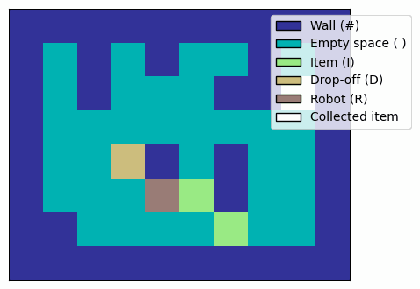
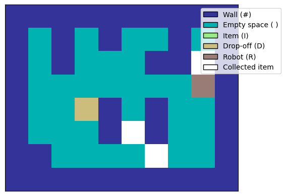
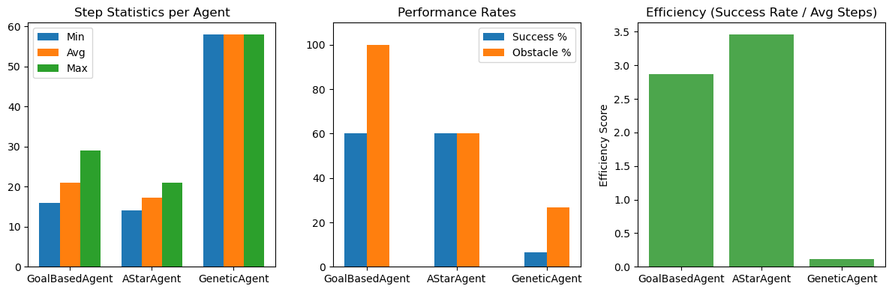
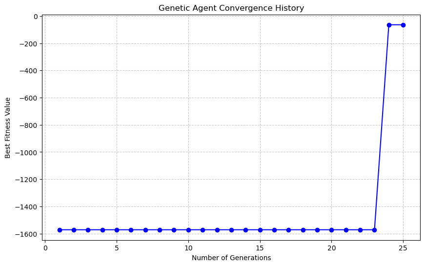

# 🤖 Warehouse Robot: Comparing AI Search & Optimisation Agents

A grid-world simulation where a robot must **collect every item and return to a drop-off point**, controlled by three different AI agents: a greedy goal-based agent, an A\* path-planner, and a genetic-algorithm planner. The project compares how each approach performs on randomly generated warehouses.

> 📌 **Note:** This is a showcase repository. The source code comes from a university assignment, so it is not published here. This README covers the approach, design decisions, and results.



*The genetic agent navigating a randomly generated warehouse (collected items turn white).*

---

## 🎯 The Problem

A robot (`R`) starts somewhere in a warehouse grid containing walls (`#`), items to pick up (`I`), and a drop-off zone (`D`). The task is complete when **all items are collected and the robot is standing on the drop-off**.

| Symbol | Meaning |
|:---:|---|
| `R` | Robot start position |
| `#` | Wall / obstacle |
| `I` | Item to collect |
| `D` | Drop-off location |

The robot moves one cell at a time (`UP`, `DOWN`, `LEFT`, `RIGHT`). Moving into a wall or off the grid wastes a step.



---

## 🧠 The Agents

All agents share a common `Agent` interface (`choose_action()`) and are plugged into the same environment, so they can be swapped and compared fairly.

### 1. Goal-Based Agent (greedy)
- Targets the **nearest item** (Manhattan distance), or the drop-off once all items are collected.
- Picks the legal move that minimises distance to the goal, breaking ties randomly.
- Avoids stepping straight back to its previous cell to reduce oscillation.
- **Strength:** simple, fast, no planning. **Weakness:** no lookahead, so it can get stuck behind walls.

### 2. A\* Agent
- Plans a full path to the nearest item (or drop-off) using **A\* search** with a Manhattan-distance heuristic and a priority queue (`heapq`).
- Replans each time it reaches a goal.
- **Strength:** finds shortest paths around obstacles. **Weakness:** the nearest-item choice is still greedy, so the overall route isn't globally optimal.

### 3. Genetic Agent
- Evolves **action sequences** (chromosomes of 25 moves) with a genetic algorithm, then executes the best plan.
- Replans when the current sequence runs out.

| Parameter | Value |
|---|---|
| Population size | 30 |
| Planning horizon | 25 moves |
| Generations per plan | 25 |
| Crossover rate | 0.8 (single-point) |
| Mutation rate | 0.12 per gene |
| Selection | Fitness-proportionate (roulette) |
| Elitism | Best individual carried over |

**Fitness function** rewards collected items, progress toward the current goal, and finishing the task, while penalising wasted steps and wall crashes. Each candidate is scored by simulating it on a deep copy of the environment.

---

## 🏗️ Architecture

```
WarehouseEnvironment     grid state, movement rules, item tracking, metrics
        │
      Agent (base)       choose_action() interface
   ┌────┼──────────┐
GoalBased  AStar   Genetic
        │
Evaluation harness       headless runs over many random maps
Visualisation            matplotlib animation of each step
```

**Other components**
- **Random map generator:** places the robot, drop-off, items, and walls at random on a bordered grid.
- **Headless evaluator:** runs each agent across multiple maps and repeated runs, with a step cap and a collision-failure rule.
- **Live visualiser:** step-by-step matplotlib rendering of the robot and collected items.
- **GA convergence tracking:** records best fitness per generation.

---

## 📊 Evaluation

**Setup:** 5 random maps × 3 runs per agent (15 runs each), on an 8×10 grid with 3 items and 10 random walls, capped at 500 steps per run.

**Metrics:** success rate, obstacle handling (runs not ending in repeated collisions), min/avg/max steps on successful runs, and efficiency (success rate ÷ average steps).



| Agent | Success rate | Efficiency |
|---|:---:|:---:|
| Goal-Based | 60.00% | 2.87 |
| **A\*** | 60.00% | **3.46** |
| Genetic | 6.67% | 0.11 |

### Findings
- **A\* was the most efficient**, reaching goals in the fewest steps on average (roughly 14–21 on successful runs).
- **The greedy agent matched A\*'s success rate** but took more steps and had a wider spread, which fits its lack of lookahead.
- **The genetic agent performed worst by a wide margin.** Its plans are open-loop and mostly random at the start, so it often walks into walls and burns steps, and with only 25 generations the population frequently fails to improve. Its convergence plot shows long plateaus followed by sudden jumps once a useful mutation appears:



- Success rates of 60% across the deterministic-style agents suggest some randomly generated maps may be unsolvable (e.g. items sealed in by walls), though I did not verify solvability per map.

### Takeaways
- Classical informed search beats a naive evolutionary planner on small, fully observable, deterministic grids, where the problem structure is easy to exploit.
- Genetic algorithms need a stronger setup (more generations, a larger population, smarter initialisation, or seeding with heuristic moves) to be competitive here.
- A fitness function that mixes many weighted terms is sensitive to its constants.

---

## 🛠️ Tech Stack

- **Python 3**
- **NumPy**, **Matplotlib** (visualisation and plots)
- Standard library: `heapq`, `random`, `copy`, `collections`
- Developed in **Jupyter / Google Colab**

---

## 🔭 Possible Improvements

- Solve the full **multi-item routing** problem (TSP-style ordering) instead of nearest-item-first.
- Add a solvability check to the map generator.
- Use a stronger GA: larger population, tournament selection, adaptive mutation, and A\*-seeded individuals.
- Try other agents such as Q-learning or Monte Carlo Tree Search.
- Run larger grids with many more trials for statistically meaningful comparisons.

---

## 📬 Contact

*Add your name, LinkedIn, and email here.*

*University assignment, AI module. Code withheld in line with academic integrity policy.*
